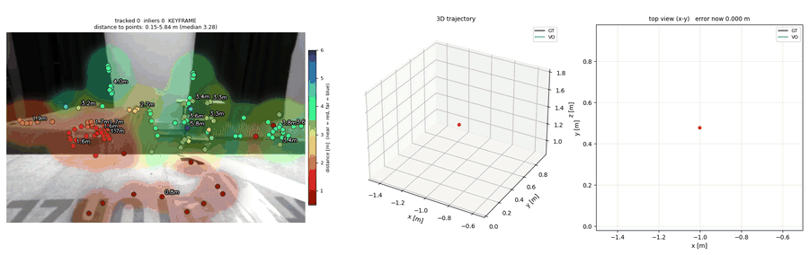

# Stereo visual odometry for a GNSS-denied MAV (EuRoC)

Stereo VO + object detection on the EuRoC MAV dataset (bachelor diploma, KNU).



*`python run_vo.py --seq data/euroc/V2_02_medium/mav0 --detector sift`, the whole sequence in 20 s:
tracked points coloured by stereo depth (near = red, far = blue) over a smoothed depth map | 3D trajectory |
top view. VO (blue) vs ground truth (black), aligned only at the first pose, as when GNSS is lost.
Result: 2309 frames, drift 0.93 % of the distance flown, ATE 0.55 m.*

## Pipeline (`vo/`)

1. **Calibration / rectification** (`euroc.py`, `features.Rectifier`): intrinsics, radial-tangential
   distortion and `T_BS` extrinsics from the EuRoC yaml files; `T_C1C0 = T_BC1⁻¹ · T_BC0`;
   `cv2.stereoRectify` makes epipolar lines image rows. The residual vertical offset is estimated online
   (`self_calibrate`, 1.7 px on V2_01).
2. **Left↔right matching** (`features.StereoMatcher`): ORB / SIFT / GFTT, grid bucketing, candidates
   only on the same row with a positive disparity, Lowe ratio test, mutual check, LK sub-pixel refinement.
3. **Triangulation**: `Z = f·B/d`, `X = (u−cx)Z/f`, `Y = (v−cy)Z/f`, into one world frame with the current pose.
4. **Tracking + PnP** (`odometry.py`): pyramidal LK with a forward–backward check; `solvePnPRansac` with a
   constant-velocity initial guess + Levenberg–Marquardt refinement; a new stereo keyframe when tracking weakens.
5. **Evaluation** (`evaluation.py`): SE(3) Umeyama ATE (Sim(3) scale as a check), first-pose-anchored drift,
   RPE over 1 s, triangulation accuracy vs the Leica laser scan, TUM files for `evo`.

## Setup

```bash
python -m venv .venv
.venv/bin/pip install -r requirements.txt          # windows: .venv\Scripts\pip install -r requirements.txt
```

EuRoC sequences (ASL format, not rosbag) from the [ETH Research Collection](https://doi.org/10.3929/ethz-b-000690084),
unzipped so that you get `data/euroc/<sequence>/mav0/{cam0,cam1,imu0,state_groundtruth_estimate0,...}`.

## Run

```bash
python run_vo.py --seq data/euroc/V2_01_easy/mav0                     # live window, results/ (metrics, plots, TUM)
python run_vo.py --seq data/euroc/V2_02_medium/mav0 --detector sift   # orb | sift | gftt
python run_vo.py --seq data/euroc/V1_01_easy/mav0 --start 200 --frames 500 --no-live
python run_vo.py --seq data/euroc/V2_01_easy/mav0 --cpu 0             # image ops on the GPU (OpenCL, any vendor)
python run_vo.py --video data/videos/cam0_vid.mp4 data/videos/cam1_vid.mp4 --seq data/euroc/V2_01_easy/mav0
python run_vo.py --compare                                            # every detector x every sequence -> results/comparison.md

python app.py                                                         # GUI: VO window + object detection
python -m detection.train --eval-only models/ssd_v2.pth               # needs the labelled frames in object_detection_data/
```

`--cpu 1` (default) is faster on EuRoC: 752×480 images are too small for the GPU transfer to pay off.

## Results (whole sequences, `python run_vo.py --compare`)

ATE = RMSE after SE(3) Umeyama alignment (no scale fit). Drift = final position error with only the
first pose aligned, as % of the distance flown (the GNSS-denied case). Depth error = median distance
of triangulated points to the Leica laser scan (V1/V2 only), using ground-truth poses.

| sequence | detector | ATE [m] | drift [%] | RPE 1 s [m / deg] | Sim3 scale | lost frames | depth err [m] |
|---|---|---|---|---|---|---|---|
| V1_01_easy (58 m) | ORB | 0.218 | 0.97 | 0.047 / 0.58 | 1.027 | 2 | 0.070 |
| | SIFT | 0.156 | 0.39 | 0.047 / 0.55 | 1.028 | 3 | 0.067 |
| | GFTT+KLT | **0.096** | 0.57 | 0.044 / 0.47 | 1.014 | 2 | 0.069 |
| V2_01_easy (36 m) | ORB | **0.097** | 0.54 | 0.020 / 0.99 | 1.030 | 94 | 0.051 |
| | SIFT | 0.115 | 0.62 | 0.016 / 0.40 | 1.009 | **5** | 0.051 |
| | GFTT+KLT | 0.192 | 1.87 | 0.018 / 0.55 | 1.033 | 96 | 0.051 |
| MH_02_easy (73 m) | ORB | 0.075 | 0.40 | 0.014 / 0.16 | 0.997 | 0 | – |
| | SIFT | **0.073** | **0.20** | 0.012 / 0.12 | 0.999 | 0 | – |
| | GFTT+KLT | 0.109 | 0.57 | 0.013 / 0.49 | 1.001 | 9 | – |

The ~95 lost frames on V2_01 are the landing on a mattress (closer than 0.15 m, repetitive texture);
only SIFT survives it. Triangulation error grows with depth as expected for stereo (σ_Z ∝ Z²/(f·B)):
~4 cm below 2 m, ~9 cm at 4–6 m. Old vs new front-end on the same 40 V1_01 frames: median depth error
vs laser **2.14 m → 0.063 m**.

Detector (SSDLite, held-out last 20 % of every labelled segment, IoU ≥ 0.5): old checkpoint
mAP50 = 0.01, retrained `models/ssd_v2.pth` mAP50 = 0.31 (board 0.67, mat 0.33, pipe 0.18, radiator 0.05).
The best epoch was picked on the same split, so this is slightly optimistic.

## What was wrong in the original code (fixed)

| # | Bug | Effect |
|---|-----|--------|
| 1 | Stereo extrinsic computed as `T_BC1·T_BC0⁻¹` instead of `T_BC1⁻¹·T_BC0` | baseline expressed in the body frame → OpenCV rectified the rig as a **vertical** stereo pair; every depth was wrong (median 2.1 m error vs laser scan, now 6 cm) |
| 2 | Left/right images paired by sorted index | V2_01 has 8 missing left images → every pair was 0.4 s apart. Now paired by timestamp |
| 3 | Re-initialisation triangulated in the *current* camera frame | pose reset at every re-init, the trajectory was unrelated pieces. Now landmarks live in one world frame |
| 4 | Only the 14 *closest* points kept | ill-conditioned PnP, re-init almost every frame |
| 5 | Stereo matching: F-matrix RANSAC or 8 px row tolerance + "use all matches if too strict", no disparity sign check | wrong correspondences; for a rectified pair the epipolar geometry is known exactly |
| 6 | Keypoints from coarse ORB octaves used directly | disparity error of several px → large depth error (∝ Z²) |
| 7 | PnP: 10 px RANSAC threshold, no refinement, no motion prior, no sanity check | noisy poses |
| 8 | Camera → body: `T_BS⁻¹` applied to a world point, rectification rotation `R1` ignored | wrong frame for the comparison with ground truth |
| 9 | GT: next sample via `searchsorted`, position only | time misalignment; now linear + SLERP interpolation |
| 10 | Evaluation only with Sim(3) Umeyama | hides scale errors (stereo is metric) → SE(3) ATE + scale + anchored drift + RPE |
| 11 | `sparse_f.py` had undefined variables (`start_frame`, `pts2`, `pts3`, ...) | the "sparse" module never ran |
| 12 | Detector trained with boxes in 752×480 px on a 320×320 tensor, double normalisation | wrong boxes, weaker transfer from pretrained weights |
| 13 | Detection metric matched every prediction to every GT, scored on training frames | meaningless score. Now IoU ≥ 0.5, AP@0.5, time-based held-out split |
| 14 | (dataset) the official V2_01 calibration leaves a 1.7–1.9 px vertical offset after rectification (≈0.24° relative pitch) | 60 % of correct matches rejected, ATE 0.92 m → online self-calibration, ATE 0.10 m |
| 15 | (found while testing) lost-frame coasting reused its own velocity, rotations never re-orthonormalised, NaN poses passed the jump check | pose overflow to 1e+200 on V2_01's landing |

## Layout

```
vo/            EuRoC loading, stereo front-end, odometry, geometry, evaluation, live view, cpu/gpu switch
detection/     SSDLite model + time-based train/val split, training, IoU/mAP metrics
run_vo.py      CLI          app.py   GUI          models/ssd_v2.pth   detector weights
docs/          diploma diagrams, demo.gif         data/   datasets + videos (not in git)
```
